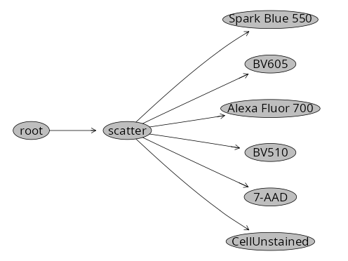

# Background

Per the README.md file, using either commercial software or [CytoExploreR](https://dillonhammill.github.io/CytoExploreR/), we need to export designated positive and negative populations as .fcs files. These in turn will get stored in designated folders "ref controls" and "af". 

For those more accustomed to the [Cytometry in R](https://umgcccfcsr.github.io/CytometryInR/course/SDY3080/SetUp.html) workflow, we can substitute in the `flowWorkspace`, `flowGate` and `Luciernaga` steps from [Signature Matrices](https://umgcccfcsr.github.io/CytometryInR/course/SDY3080/SignatureMatrices.html) to equivalently reach the same point. 

# Walk-through

## Set Up

Since this is not in the original scripts, the respective R packages will likely need to be installed. 

```{r}
if (!requireNamespace("flowWorkspace", quietly = TRUE)) BiocManager::install("flowWorkspace")
if (!requireNamespace("Luciernaga",
 quietly = TRUE)) remotes::install_github("https://github.com/DavidRach/Luciernaga")
if (!requireNamespace("flowGate",
 quietly = TRUE)) remotes::install_github("https://github.com/NKInstinct/flowGate", ref="244faae")
```

Proceed to attach the required R packages to your local environment via the `library()` call. 

```{r}
library(flowWorkspace)
library(Luciernaga)
library(flowGate)
library(dplyr)
library(stringr)
```

Identify the .fcs files in their respective folder by providing the `file.path()` and `list.files()` function. We can then use `load_cytoset_from_fcs()` and `GatingSet()` to bring them into a GatingSet for the subsequent steps. 

```{r}
UnmixingControlsFolder <- file.path("data", "unmixing_controls")
fcs_files <- list.files(UnmixingControlsFolder, pattern=".fcs", full.names=TRUE)
TheCytoset <- load_cytoset_from_fcs(fcs_files, truncate_max_range = FALSE, transformation=FALSE)
TheGatingSet <- GatingSet(TheCytoset)
```

```{r}
TheGatingSet
```

Don't forget to transform with instrument appropiate settings

```{r}
SFC_Parameters <- colnames(TheGatingSet)
FluorophoresOnly <- SFC_Parameters[!stringr::str_detect(SFC_Parameters, "FSC|SSC|Time")]

Biexponential <- flowjo_biexp_trans(channelRange=4096, maxValue=4194304,
  pos=5.62, neg=0, widthBasis=-1000)
MyBiexTransform <- transformerList(FluorophoresOnly, Biexponential)
transform(TheGatingSet, MyBiexTransform)
```

## Updating Metadata

To facilitate signature extraction, we need to tidy up the existing metadata. Retrieve the existing metadata using `pData()`, then we will extract the desired strings from the filename to fill out the Fluorophore, Antigen and Type columns

```{r}
pd <- pData(TheGatingSet)

Updated_cell_pd <- pd |> mutate(
    raw = str_extract(name, "(?<=PD_AD_)[^(]+(?=\\()"),
    Antigen = raw |>
      str_trim() |>
      str_extract("^\\S+"),
    Fluorophore = raw |>
      str_trim() |>
      str_remove("^\\S+\\s+") |>
      str_trim(),
    Type = name |>
      str_extract("(?<=\\()([^)]+)(?=\\))"),
    raw = NULL
  )

Updated_cell_pd <- Updated_cell_pd |> 
  mutate(Fluorophore = case_when(
    name == "Unstained (Cells)_scatter.fcs" ~ "CellUnstained",
    TRUE ~ Fluorophore
  ))

Updated_cell_pd <- Updated_cell_pd |> 
  mutate(Antigen = case_when(
    name == "Unstained (Cells)_scatter.fcs" ~ "AF",
    TRUE ~ Fluorophore
  ))

Updated_cell_pd <- Updated_cell_pd |>
    relocate(Fluorophore, Antigen, Type, .after="name")
```

```{r}
Updated_cell_pd
```

If everything looks good, proceed to assign the metadata back to GatingSet

```{r}
pData(TheGatingSet) <- Updated_cell_pd
pData(TheGatingSet)
```

Lastly, for our gating template we will need a Detector and Negative column. 

```{r}
NumberDetectors <- 64 # On a 5-laser Cytek Aurora

Template <- pData(TheGatingSet)
Template <- Template |> mutate(Detector="", Negative="CellUnstained")

Template <- Template |> mutate(
    Detector = purrr::map_chr(Fluorophore, \(f) DetectorGuess(x = f, NumberDetectors = NumberDetectors))
  )

Template <- Template |> mutate(Detector = case_when(
        name == "Unstained (Cells)_scatter.fcs" ~ "V7",
        TRUE ~ Detector
      ))


Template
```

## Creating Clean Up Gates

With our template setup, and our files loaded into a GatingSet, we can add draw cleanup gates to ensure we are only providing our cell type of interest when we draw the positive gates. 

To do this, we will leverage the `flowGate` packages ShinyApp. 

```{r}
CellGatingTable <- tibble::tribble(
  ~filterId,    ~dims,                          ~subset,      
  "scatter",   list("FSC-A", "SSC-A"),          "root",  
)
```

Create an initial gate based on one specimen (if using provided examples, we already downsampled so include everything!) 

```{r}
#| eval: FALSE
flowGate::gs_apply_gating_strategy(TheGatingSet, gating_strategy = CellGatingTable)
```

And check the gates across individual specimens. Don't forget to leave dead cells for the viability unmixing control!

```{r}
#| eval: FALSE
gs_apply_gate_check(gs=TheGatingSet, gate="scatter")
```


## Creating Positive Gates

With our template setup, we can use the `Luciernaga` packages `InitialUnmixSpanGates()` to rapidly implement the corresponding positive gates via the `flowGate` packages Shiny App. 

```{r}
#| eval: FALSE

# Run Manually
InitialUnmixSpanGates(template=Template, gs=TheGatingSet, subset="scatter", minpercentile=0.75, maxpercentile = 0.99)
```

If using the provided example files, the new gates should be visible when running `plot()` on our GatingSet. 

```{r}
#| eval: FALSE

# Run Manually
plot(TheGatingSet)
```



Next up, we can adjust the gate placement using the `flowGate` ShinyApp by drawing new spans for the areas of the positive peak we want to include. For the unstained, we would include the entire negative peak. 

```{r}
#| eval: FALSE

# Run Manually
CheckUnmixingSpanGates(template=Template, gs=TheGatingSet, AdjustAll=TRUE)
```

We can then work on exporting the cells that are present within each gate out as their own .fcs file via the Downsampling.R file in the R folder. 

## Exporting gates as individual .fcs files

Next up, lets use the modified "Downsampling" function from [CytometryInR](https://umgcccfcsr.github.io/CytometryInR/course/10_Downsampling/#export) that is in our R folder.  We run `source()` to activate the function in our local environment. 

```{r}
TheDownsamplingFunction <- file.path("R", "Downsampling.R")
source(TheDownsamplingFunction)
```

To stick with the original naming syntax, we will need to do some tidying on our template. We can also make a vector of the equivalent gates and isolate the SingleColors from the unstained reference. 

```{r}
NewNames <- Template |> 
  select(Antigen, Fluorophore) |> filter(!Fluorophore %in% "CellUnstained") |>
  mutate(NewName = paste(Antigen, Fluorophore, "pos", sep = "_")) |> pull(NewName)

TheGates <- Template |> 
  select(Antigen, Fluorophore) |> filter(!Fluorophore %in% "CellUnstained") |> pull(Fluorophore)

SingleColors <- subset(TheGatingSet, Antigen != "AF")
```

Next, using the `purrr` packages `pmap` function, we can iterate through the specimens, extract their corresponding gate, and write out with the correct name to our "ref controls" folder

```{r}
#| eval: FALSE

purrr::pmap(
  .l = list(
    x      = SingleColors, 
    subset = TheGates,
    rename = NewNames
  ),
  .f = Downsampling,
  DownsampleCount=10000000,
  StorageLocation = "ref controls"
)
```

And last but certainly not least, we can repeat this process for our unstained. 

```{r}
#| eval: FALSE

Unstained <- subset(TheGatingSet, Antigen == "AF")

TheGates <- Template |> 
  select(Antigen, Fluorophore) |> filter(Fluorophore %in% "CellUnstained") |> pull(Fluorophore)

NewNames <- "Unstained"

purrr::pmap(
  .l = list(
    x      = Unstained, 
    subset = TheGates,
    rename = NewNames
  ),
  .f = Downsampling,
  DownsampleCount=10000000,
  StorageLocation = "af"
)
```

And finished!

# Take Away

At this point, our "ref controls" and "af" folders have the equivalent files that are needed to follow along for the various unmixing examples. No commercial software required. 

# Additional Resources

[]()

```{r}
sessionInfo()
```

