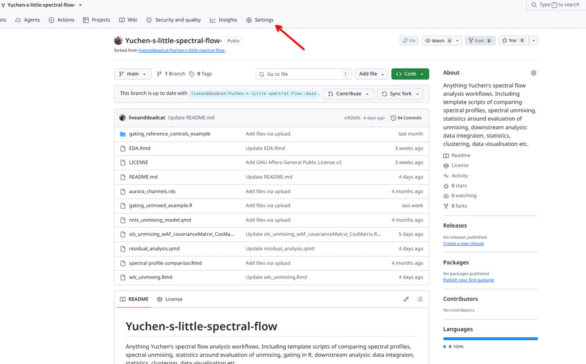
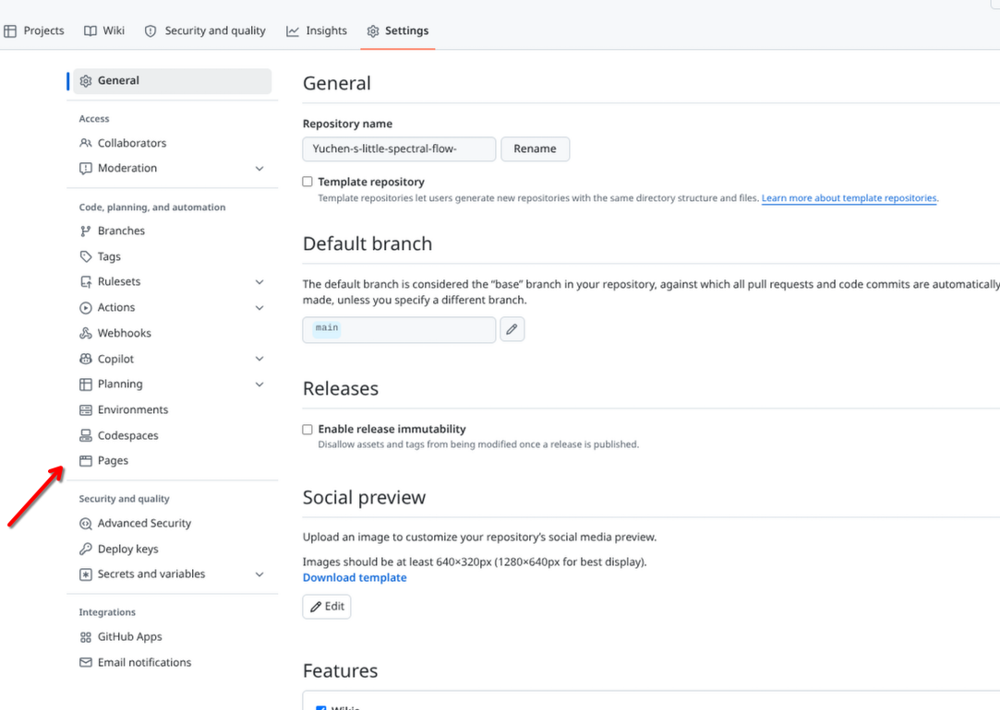
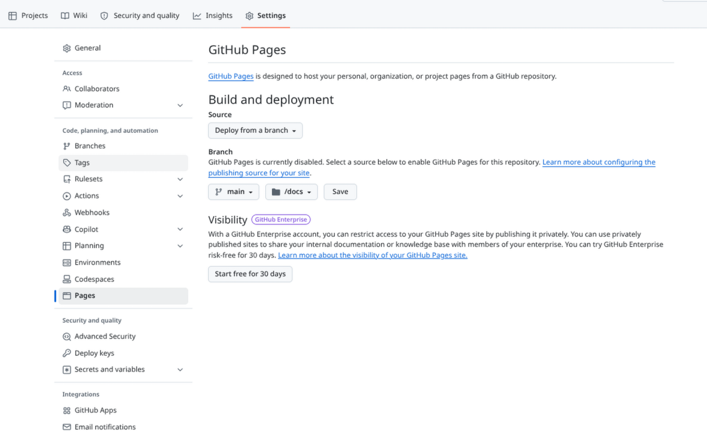

If you want to share the website version on GitHub pages, there are a couple additional steps for setup after addition of the index.qmd and _quarto.yml files. First off, render the website via your terminal with the following

```{r}
#| eval: FALSE

# In your terminal when at the working directory level, run 

quarto render
```

Once this is accomplished, add, commit and push your changes back to GitHub. 

From there, navigate to Settings



Select Pages



Then select deploy from Branch, then the appropiate branch and docs folder. 



At which point you should be set. 
